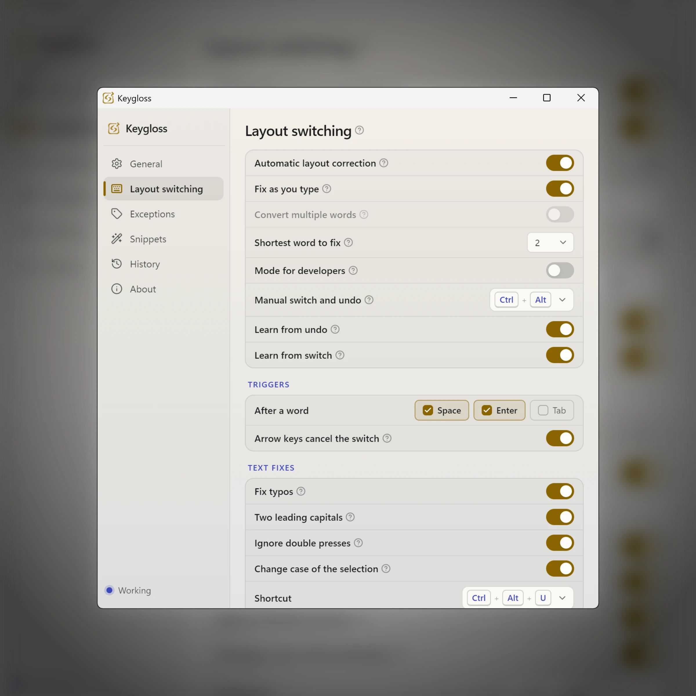
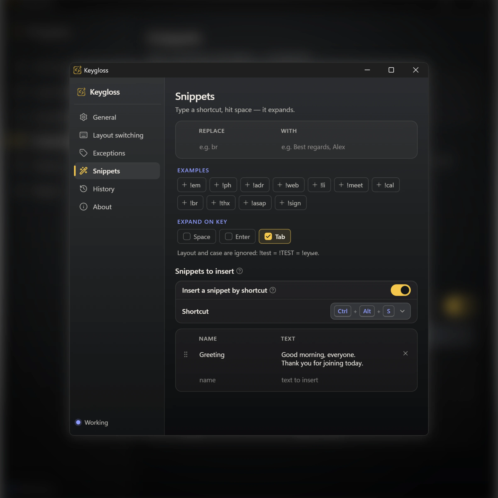

<p align="center">
  
</p>

<h1 align="center">Keygloss</h1>

<p align="center">Privacy-first modern Punto-Switcher alternative</p>

<p align="center">
  <b>English</b> ·
  <a href="docs/readme/README.ru.md">Русский</a>
</p>

<p align="center">
  <a href="https://keygloss.app"></a>
</p>

---

Type `ghbdtn`, get `привет`, and the layout switches to match. RU ↔ EN, as you type or with a hotkey.

## Features

- Typo fixes, snippets and per-app exceptions.
- History of recent automatic fixes, stored only on this computer.
- Updates from GitHub, stable or beta.
- Supported languages: English and Russian.

## Screenshots

<table>
  <tr>
    <td width="50%"></td>
    <td width="50%"></td>
  </tr>
  <tr>
    <td align="center"><sub>Layout switching: auto-correction, triggers and text fixes</sub></td>
    <td align="center"><sub>Snippets: shortcuts that expand into text</sub></td>
  </tr>
</table>

## Install

| Platform | Command |
| --- | --- |
| Windows | `winget install xArchange1.keygloss` |
| macOS | `brew install --cask xArchange1/tap/keygloss`<br><br>Doesn't work. [Sponsor](https://github.com/xArchange1/keygloss#sponsor) to get me an Apple Developer ID.  |
| Linux | <code>curl -fsSL https://raw.githubusercontent.com/xArchange1/keygloss/main/packaging/linux/install.sh | sh</code> |

On macOS, allow Keygloss in System Settings > Privacy & Security > Accessibility on first launch.

### Linux

The script installs the `.deb` (Debian, Ubuntu) or `.rpm` (Fedora, openSUSE) from the latest release, for x86_64. Run it again to update: Keygloss reports new versions but does not install them itself. You can also install a package from [Releases](https://github.com/xArchange1/keygloss/releases) by hand.

- Needs KDE Plasma 6 on Wayland: Keygloss reads and switches layouts through it. Other desktops and X11 sessions are not supported yet.
- Keygloss reads the keyboards directly (`/dev/input`) and types through a virtual keyboard (`uinput`). The package adds a udev rule that gives the user at the computer access to both. Any program you run can then read your keyboard input too.
- Selected text is read with Ctrl+C, and password fields are not detected. Text that no installed layout can type is pasted with Ctrl+V, which terminals ignore.

## Development

Requires Rust (MSVC on Windows, Xcode Command Line Tools on macOS), Node and pnpm. On Linux, also the [Tauri prerequisites](https://tauri.app/start/prerequisites/#linux) and `libxkbcommon-dev`.

```
pnpm install
pnpm tauri dev
```

## Privacy

Keygloss processes your typing only on this computer and collects no usage data or telemetry. It connects to the internet only:

- to check GitHub for a newer release on startup, and to download it. Turn this off in Settings → General ("Check for updates on startup").
- when you click a link, which opens your web browser.

## Sponsor

If Keygloss saves you some retyping, you can support its development on [Boosty](https://boosty.to/xarchange1/donate).

## Credits

Inspired by [Keyboop](https://keyboop.com) ([GitHub](https://github.com/iffuno/keyboop)). Its author doesn't plan Windows or Linux versions, so Keygloss fills the gap.

## License

MIT, see [LICENSE](LICENSE).
