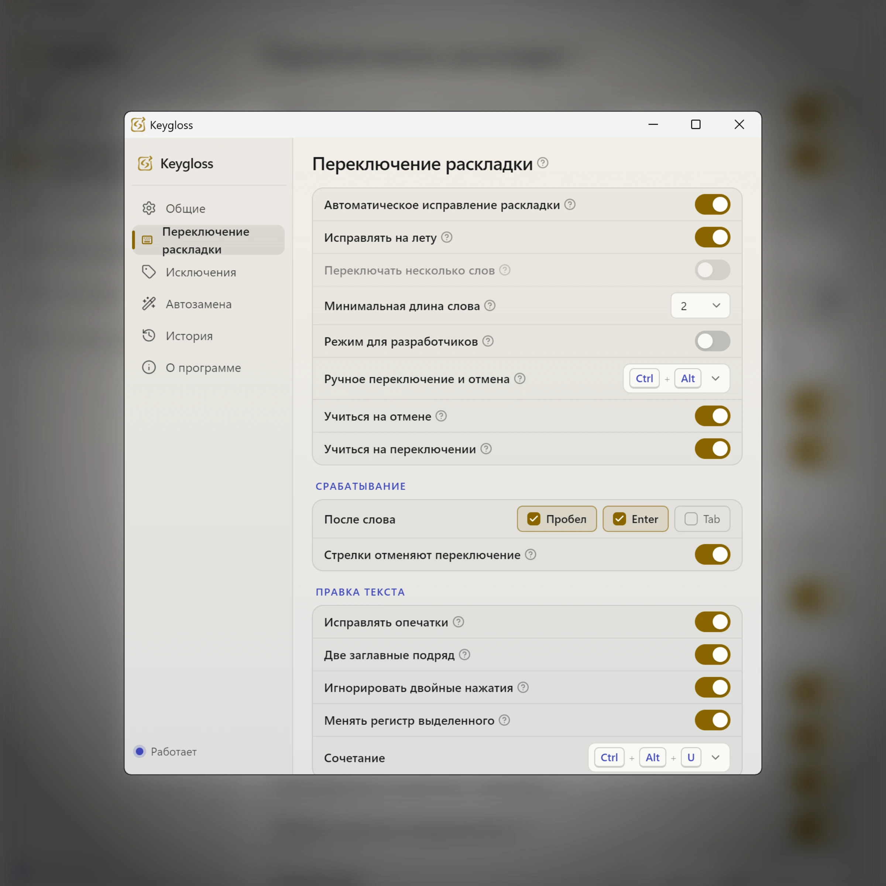
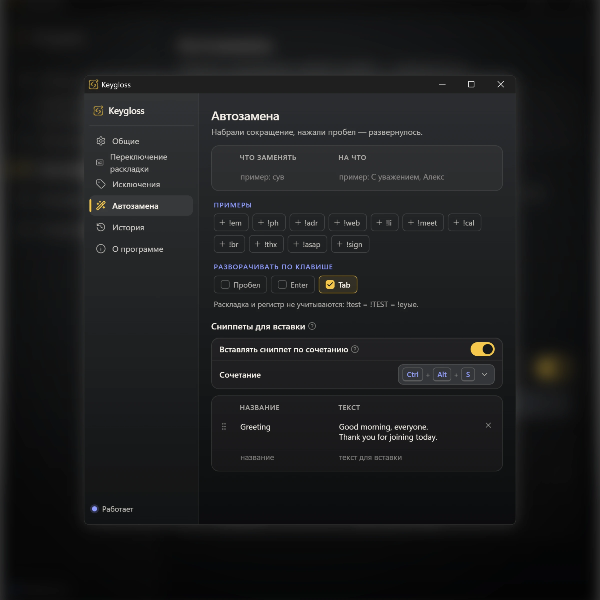

<p align="center">
  
</p>

<h1 align="center">Keygloss</h1>

<p align="center">Приватная современная альтернатива Punto Switcher</p>

<p align="center">
  <a href="../../README.md">English</a> ·
  <b>Русский</b>
</p>

<p align="center">
  <a href="https://keygloss.com/ru/"></a>
</p>

---

Набираете `ghbdtn`, получаете `привет`, и раскладка переключается сама. RU ↔ EN, на лету или по сочетанию клавиш.

## Возможности

- Исправление опечаток, сниппеты и исключения для программ.
- История последних автоматических исправлений, хранится только на этом компьютере.
- Обновления с GitHub, стабильные или бета.
- Поддерживаемые языки: английский и русский.

## Скриншоты

<table>
  <tr>
    <td width="50%"></td>
    <td width="50%"></td>
  </tr>
  <tr>
    <td align="center"><sub>Переключение раскладки: автоисправление, срабатывание и правка текста</sub></td>
    <td align="center"><sub>Сниппеты: сокращения, которые разворачиваются в текст</sub></td>
  </tr>
</table>

## Установка

| Система | Команда |
| --- | --- |
| Windows | `winget install xArchange1.keygloss` |
| macOS | `brew install --cask xArchange1/tap/keygloss`<br><br>[Поддержите проект](https://github.com/xArchange1/keygloss#sponsor), чтобы помочь с покупкой Apple Developer ID. |
| Linux | <code>curl -fsSL https://raw.githubusercontent.com/xArchange1/keygloss/main/packaging/linux/install.sh | sh</code> |

### Linux

Скрипт устанавливает `.deb` (Debian, Ubuntu) или `.rpm` (Fedora, openSUSE) из последнего выпуска, для x86_64. Чтобы обновиться, запустите его снова: Keygloss сообщает о новых версиях, но сам их не устанавливает. Пакет можно установить и вручную из [Releases](https://github.com/xArchange1/keygloss/releases).

- Нужна KDE Plasma 6 на Wayland: через неё Keygloss читает и переключает раскладки. Другие среды и сеансы X11 пока не поддерживаются.
- Keygloss читает клавиатуры напрямую (`/dev/input`) и печатает через виртуальную клавиатуру (`uinput`). Пакет добавляет правило udev, которое даёт к ним доступ пользователю, вошедшему в систему. Читать ввод с клавиатуры после этого может и любая запущенная вами программа.
- Выделенный текст читается через Ctrl+C, поля паролей не распознаются. Текст, который не набрать ни в одной из установленных раскладок, вставляется через Ctrl+V, а терминалы это сочетание не принимают.

## Разработка

Нужны Rust (MSVC на Windows, Xcode Command Line Tools на macOS), Node и pnpm. На Linux — ещё [зависимости Tauri](https://tauri.app/start/prerequisites/#linux) и `libxkbcommon-dev`.

```
pnpm install
pnpm tauri dev
```

## Конфиденциальность

Keygloss обрабатывает ввод только на этом компьютере и не собирает ни данных об использовании, ни телеметрии. В интернет он выходит только:

- чтобы при запуске проверить на GitHub, нет ли новой версии, и скачать её. Это отключается в разделе «Настройки → Общие» («Проверять обновления при запуске»).
- когда вы нажимаете на ссылку: она открывается в браузере.

## Благодарности

Вдохновлено [Keyboop](https://keyboop.com) ([GitHub](https://github.com/iffuno/keyboop)). Его автор не планирует версии для Windows и Linux, поэтому появился Keygloss.

## Лицензия

MIT, см. [LICENSE](../../LICENSE).
